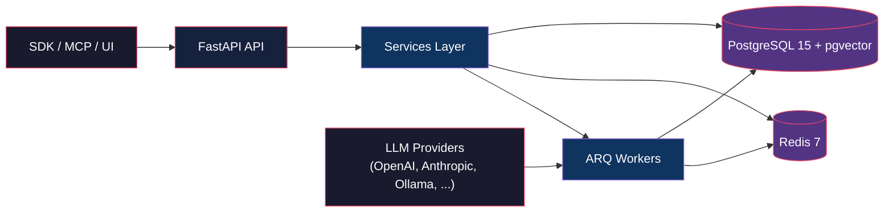

# OpenZync

**Persistent, queryable, graph-based memory for AI agents.**

OpenZync is an open-source agent memory platform. It ingests conversational data, enriches it asynchronously into a knowledge graph with entities, facts, and embeddings, and exposes a hybrid search API for LLM context retrieval.

Built for developers who need persistent agent memory without vendor lock-in — bring your own LLM (OpenAI, Anthropic, Ollama, Azure, OpenRouter) and your own infrastructure.

## Architecture

## Repository Structure

| Component | Description | License |
|---|---|---|
| **openzync-core** | Backend API — FastAPI, async SQLAlchemy, ARQ workers, LLM orchestration, graph backends, auth, multi-tenancy | AGPL 3.0 |
| **openzync-frontend** | Admin dashboard — Next.js, D3.js graph viz, Radix UI | MIT |
| **openzync-sdk-python** | Python client SDK — sync/async clients, LangChain integrations (chat history, memory, graph retriever) | Apache 2.0 |
| **openzync-mcp** | MCP server — Model Context Protocol tools for any MCP-compatible client | Apache 2.0 |
| **openzync-landing** | Marketing site — Next.js, MDX content, hosted at [openzync.tech](https://openzync.tech) | MIT |
| **openzync-docs** | Documentation — Sphinx + Furo + MyST, hosted on ReadTheDocs | CC BY 4.0 |
| **infra** | Deployment configs — Docker Compose, Helm charts, Prometheus/Grafana, OpenBao bootstrap | AGPL 3.0 |

## Quick Links

- **App**: [app.openzync.tech](https://app.openzync.tech)
- **Landing**: [openzync.tech](https://openzync.tech)
- **Documentation**: [openzync.readthedocs.io](https://openzync.readthedocs.io)
- **PyPI**: `pip install openzync`
- **License inquiries**: rohnsha0@gmail.com / prasadnikita611@gmail.com

## License

OpenZync components are available under different licenses:

- **Core platform** (openzync-core) — **AGPL 3.0**: modifications must be released if offered as a service.
- **SDK, MCP server** — **Apache 2.0**: permissive for integration into proprietary applications.
- **Frontend, landing** — **MIT**: permissive.
- **Documentation** — **CC BY 4.0**: attribution required.

A **commercial license** is available from Rohan Shaw for SaaS deployments that require AGPL exceptions.

## Authors

**OpenZync** is built and maintained by **Rohan Shaw and Nikita Prasad**.

- Rohan Shaw (AI Engineer)
- Nikita Prasad (AI Engineer)

---

*Self-hostable agent memory. No vendor lock-in. Your LLMs, your infrastructure.*
