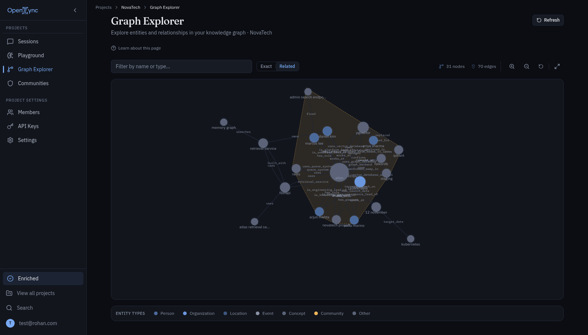

<p align="center"></p>

# OpenZync

**Graph memory that survives production.**

Open-source temporal knowledge graph where facts supersede instead of overwriting — hybrid retrieval over PostgreSQL, FalkorDB and SurrealDB, five LLM providers, an MCP server, and a typed Python SDK.

<p align="center">
  <a href="https://github.com/openzync/openzync-core/blob/master/LICENSE"></a>
  
  
  
  <a href="https://docs.openzync.tech/en/latest/"></a>
</p>

[Docs](https://docs.openzync.tech/en/latest/) · [Live app](https://app.openzync.tech) · [Site](https://openzync.tech) · [PyPI](https://pypi.org/project/openzync/) · [Contact](mailto:rohnsha0@gmail.com)

## Try it

```bash
pip install openzync
```

```python
from openzync import OpenZync

client = OpenZync(api_key="oz_live_...")  # base_url defaults to http://localhost:8000
client.memory.ingest(messages=[{"role": "user", "content": "I work at Acme."}], session_id="s1")
for hit in client.graph.search("Acme", types="episodes,facts"):
    print(hit["content"])
```

When a new fact contradicts an active one, the old fact's validity range is closed and the new fact inserted in the same transaction. Nothing is overwritten and nothing is dropped, so as-of queries still return what was true at any point.

<p align="center"></p>

*Graph Explorer over 31 nodes and 70 edges; one detected community outlined, entities colored by type.*

## Benchmark

87.1 % overall on LongMemEval-S (436/500). Temporal reasoning and knowledge update are both 100 %; multi-session is 66.9 % and preference 50.0 %. Retrieval R@1 0.816, R@5 0.834, R@10 0.840.

<sub>500 questions, run 2026-10-10 at commit `9e2fd5e`; judge `nvidia/nemotron-3-ultra-550b` (temperature 0); reranker disabled. This run predates the v1.0.0 tag. Reproduce with [`benchmarks/run_longmemeval.py`](https://github.com/openzync/openzync-core/blob/master/benchmarks/run_longmemeval.py).</sub>

## Repositories

| Repository | What it is | License |
|---|---|---|
| [openzync-core](https://github.com/openzync/openzync-core) | Backend API, workers, graph backends, auth; deployment configs in `infra/` | AGPL-3.0 |
| [openzync-python-sdk](https://github.com/openzync/openzync-python-sdk) | Typed Python client, sync and async, published as `openzync` on PyPI | Apache-2.0 |
| [openzync-mcp](https://github.com/openzync/openzync-mcp) | MCP server for any MCP-compatible client | Apache-2.0 |
| [openzync-frontend](https://github.com/openzync/openzync-frontend) | Admin dashboard: Graph Explorer, memory browser, tenant admin | MIT |
| [openzync-docs](https://github.com/openzync/openzync-docs) | Sphinx documentation and ADRs | CC BY 4.0 |
| [openzync-landing](https://github.com/openzync/openzync-landing) | Marketing site and blog | MIT |

[Contributing](https://github.com/openzync/.github/blob/main/CONTRIBUTING.md) · [Code of conduct](https://github.com/openzync/.github/blob/main/CODE_OF_CONDUCT.md) · [Security policy](https://github.com/openzync/.github/blob/main/SECURITY.md) · [Support](https://github.com/openzync/.github/blob/main/SUPPORT.md)

AGPL-3.0 covers the core: modifications you offer as a service must be released. Commercial licensing for SaaS exceptions: rohnsha0@gmail.com. Maintained by Rohan Shaw and Nikita Prasad. Star a repository if it helps you ship.
